# CodetyHub

CodetyHub is a multi-tier, personalized AI-assisted STEM learning platform featuring a Flutter mobile client app, a Node.js Express API Gateway bridge, a Python FastAPI Machine Learning microservice, and a PostgreSQL persistent database.

---

## Repository Link
https://github.com/thepatrickniyo/codetyhub-app.git

---

## Demo Video

Walkthrough Video: https://www.youtube.com/watch?v=wIPskjtT8Ug 

Watch the demonstration video showing the platform navigation, interactive course player, GitHub Gist code evaluation, AI recommendations, live leaderboard, and student portfolio.

---

## Application Screenshots

Here is a preview of the CodetyHub application interface:

<p align="center">
  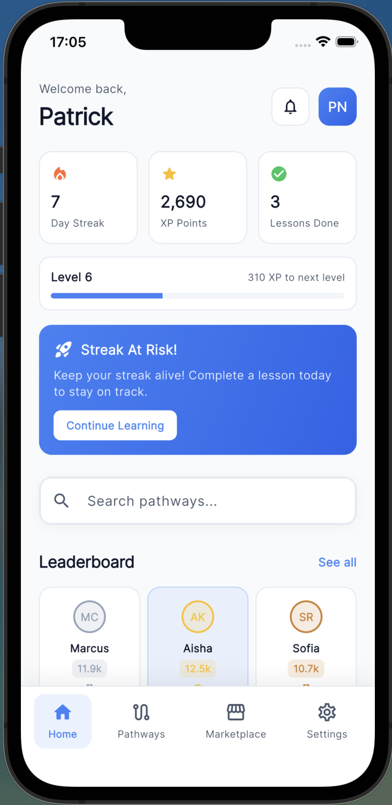
  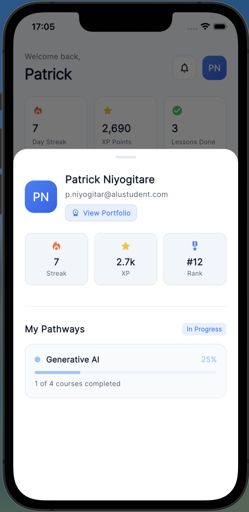
  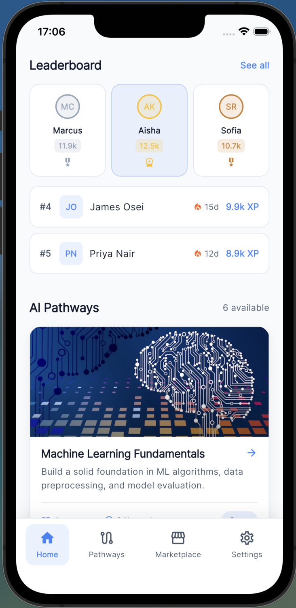
</p>

<p align="center">
  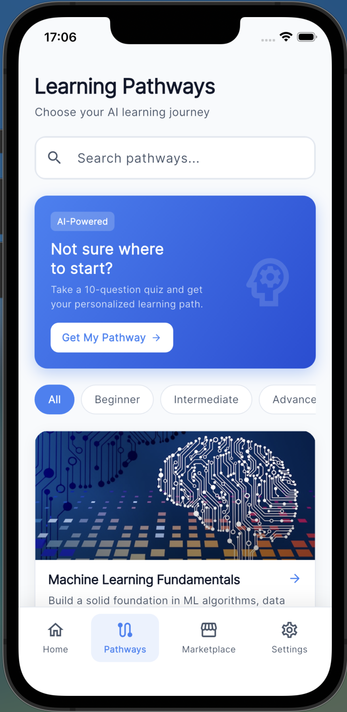
  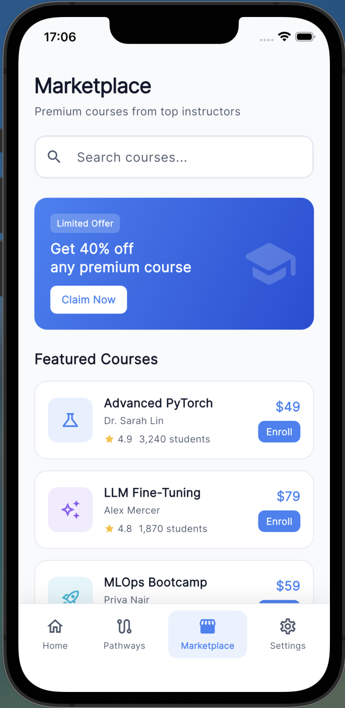
  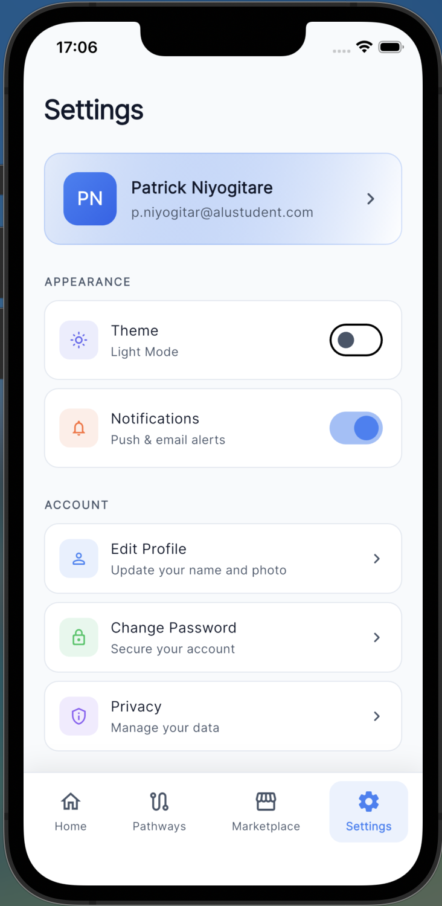
</p>

<p align="center">
  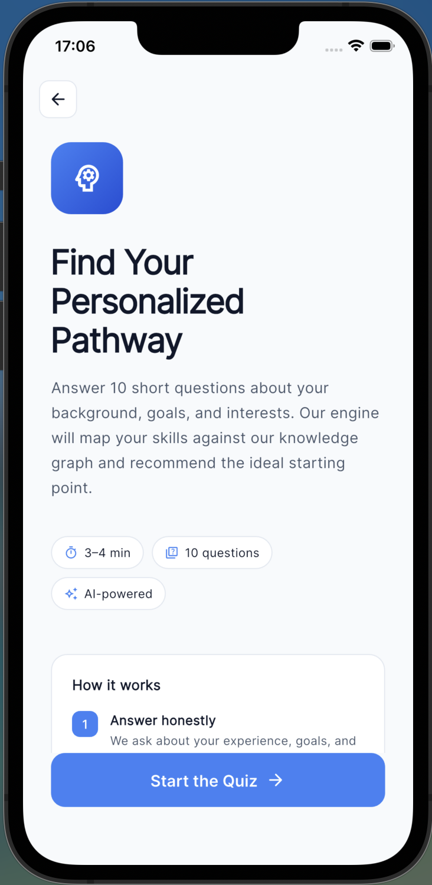
  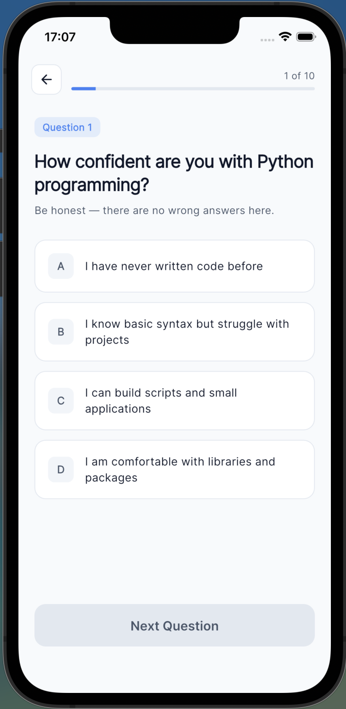
  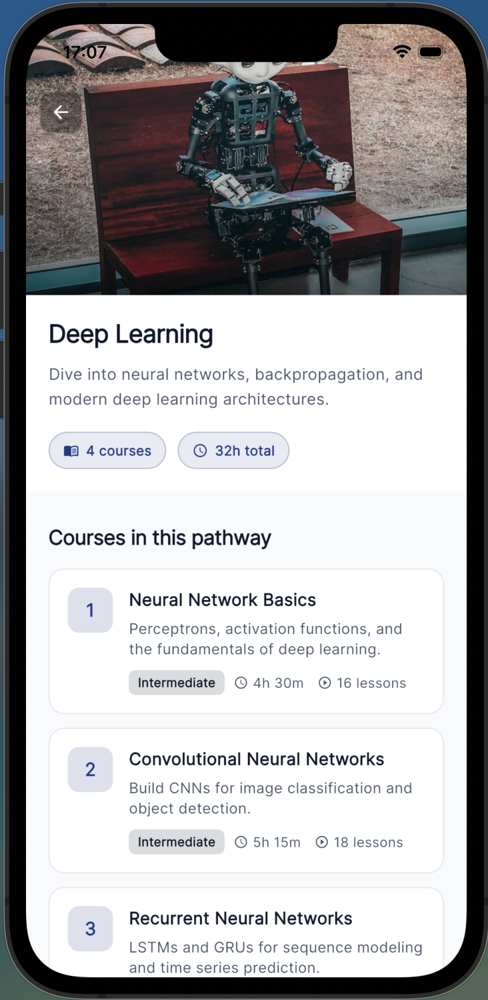
</p>

<p align="center">
  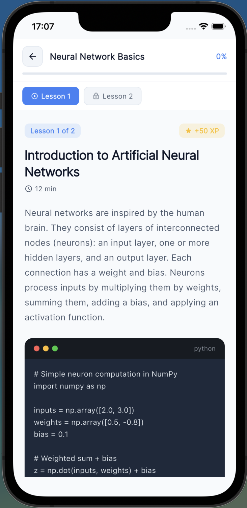
  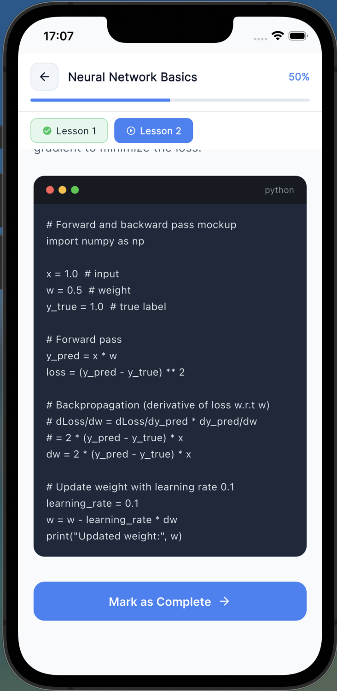
  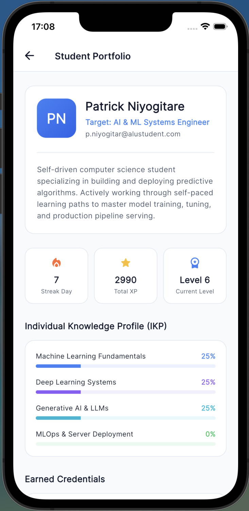
</p>

<p align="center">
  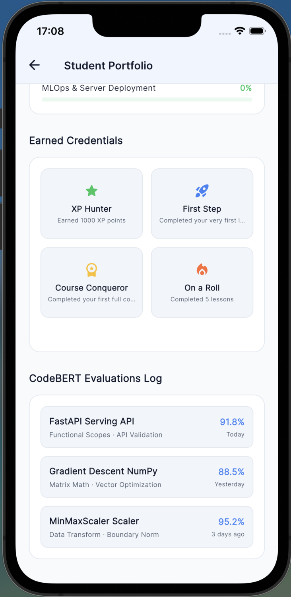
</p>

---

## System Architecture

CodetyHub is designed as a decoupled, multi-tier system:

```text
+-------------------------------------------------------------+
|                     Flutter Client (GetX)                   |
| - Theme Management (persisted via GetStorage)               |
| - Modular View Architecture (Home, Pathways, Settings, etc.)|
| - Gamification system + Local State tracking                |
+------------------------------|------------------------------+
                               | REST / HTTP Requests
                               v
+-------------------------------------------------------------+
|                Node.js Express API Gateway                  |
| - PostgreSQL DB connection pool (Users, Progress, History)   |
| - Authentication verification & CORS middleware             |
| - Proxying & Normalising communications to ML Service       |
+------------------------------|------------------------------+
                               | Internal REST / Proxied JSON
                               v
+-------------------------------------------------------------+
|             Python FastAPI ML Microservice                  |
| - Curriculum Prerequisite DAG builder (NetworkX)            |
| - User SVD Collaborative Filtering recommender (scikit-learn)|
| - Behavioural Student Dropout Risk predictor (XGBoost)       |
| - Fine-Tuned CodeBERT semantic evaluator (PyTorch)          |
+-------------------------------------------------------------+
```

---

## Service Port Map
- PostgreSQL Database: `localhost:5435`
- Python FastAPI ML Service: `http://localhost:8000`
- Node.js Express Gateway: `http://localhost:3001`
- Flutter Mobile Client: Mobile Emulator / iOS Simulator / Web

---

## How to Run Every Service

Follow these steps to start all 4 services in local development mode:

### 1. Docker PostgreSQL Database
Start the persistent database container hosting student profiles, XP, streaks, and submission histories:

```bash
# From repository root
docker compose up -d
```
Database Connection: Host `localhost`, Port `5435`, Database `codetyhub_db`, User `codetyhub_user`, Password `codetyhub_password`.

### 2. Python FastAPI Machine Learning Microservice (`ML/`)
The ML service powers the curriculum DAG graph, SVD recommender, XGBoost dropout risk predictor, and fine-tuned CodeBERT evaluator:

```bash
# Set up virtual environment and install dependencies
python3 -m venv ML/.venv
source ML/.venv/bin/activate
pip install -r ML/requirements.txt

# Start FastAPI server on port 8000
uvicorn ML.api.main:app --reload --port 8000
```
- Local Endpoint: `http://localhost:8000`
- Swagger Documentation: `http://localhost:8000/docs`

### 3. Node.js Express Gateway (`node-bridge/`)
The API gateway bridges requests from Flutter to PostgreSQL and FastAPI:

```bash
cd node-bridge
npm install
cp .env.example .env
npm run dev
```
- API Gateway URL: `http://localhost:3001`

### 4. Flutter Mobile Client App (`app/`)
Start the mobile companion app:

```bash
cd app
flutter pub get
flutter run
```

---

## Testing Guide: Running and Writing Tests

This project enforces automated testing across all three tiers: Flutter Client, Node Gateway, and Python ML Microservice.

### 1. Flutter Client Tests (`app/`)

#### Running Flutter Tests
```bash
cd app
flutter test
```

#### Writing Flutter Unit and Widget Tests
Create test files in `app/test/` with filenames ending in `_test.dart` (for example, `app/test/controllers_test.dart`):

```dart
import 'package:flutter_test/flutter_test.dart';
import 'package:get/get.dart';
import 'package:codetyhub_app/app/controllers/gamification_controller.dart';

void main() {
  TestWidgetsFlutterBinding.ensureInitialized();

  group('GamificationController Tests', () {
    late GamificationController controller;

    setUp(() {
      Get.reset();
      controller = GamificationController();
    });

    test('Initial XP and Level Calculation', () {
      expect(controller.xp.value, greaterThanOrEqualTo(0));
      expect(controller.level, equals((controller.xp.value ~/ 500) + 1));
    });

    test('Record CodeReview Evaluation Updates VSS and XP', () {
      final initialXp = controller.xp.value;
      controller.recordCodeReviewEvaluation(
        newVssScore: 92.5,
        skillNode: 'linear_regression',
        leaderboardRank: 1,
      );

      expect(controller.vssScore.value, equals(92.5));
      expect(controller.xp.value, greaterThan(initialXp));
    });
  });
}
```

### 2. Node.js Gateway Tests (`node-bridge/`)

#### Running Node.js Tests
```bash
cd node-bridge
npm test
```

#### Writing Node.js Integration Tests
Create test scripts under `node-bridge/test/` using Node's built-in test runner or Supertest:

```javascript
const test = require('node:test');
const assert = require('node:assert');
const http = require('http');

test('GET /health returns status 200 and success payload', async () => {
  const response = await new Promise((resolve, reject) => {
    http.get('http://localhost:3001/health', (res) => {
      let data = '';
      res.on('data', chunk => data += chunk);
      res.on('end', () => resolve({ statusCode: res.statusCode, body: JSON.parse(data) }));
    }).on('error', reject);
  });

  assert.strictEqual(response.statusCode, 200);
  assert.strictEqual(response.body.status, 'ok');
});
```

### 3. Python ML Service Tests (`ML/`)

#### Running Python ML Tests
```bash
source ML/.venv/bin/activate
pytest ML/tests
```

#### Writing Python Unit Tests
Add test modules under `ML/tests/test_evaluator.py`:

```python
import pytest
from fastapi.testclient import TestClient
from ML.api.main import app

client = TestClient(app)

def test_code_review_evaluation_endpoint():
    payload = {
        "student_id": "usr-test-001",
        "skill_node": "linear_regression",
        "code_text": "import numpy as np\ndef fit(X, y):\n    return np.linalg.inv(X.T @ X) @ X.T @ y"
    }
    response = client.post("/code-review/evaluate", json=payload)
    assert response.status_code == 200
    data = response.json()
    assert data["success"] is True
    assert "vss" in data["data"]
    assert 0.0 <= data["data"]["vss"] <= 100.0
```

---

## Datasets & ML Training Data

CodetyHub's CodeBERT semantic evaluation model is fine-tuned using open-source datasets combined with synthetic curriculum benchmarks:

1. **Google MBPP (Mostly Basic Python Problems)**: 427 Python problems harvested from Google Research. Cleaned file: `ML/code_review/dataset/mbpp_cleaned.jsonl`.
2. **CodeSearchNet Python**: 463,000+ Python function records from GitHub. Cleaned file: `ML/code_review/dataset/codesearchnet_cleaned.jsonl`.
3. **Master Training Notebook**: `Patrick_Niyogitare_Summative_Assignment_Model_Training_and_Evaluation.ipynb`.

To execute the master notebook pipeline:
```bash
jupyter nbconvert --to notebook --execute Patrick_Niyogitare_Summative_Assignment_Model_Training_and_Evaluation.ipynb --inplace
```

---

## Deployment Plan

1. **Backend Gateway (Node.js Express Bridge)**: Deployed to Render Web Service from `node-bridge/`.
2. **Machine Learning Core (Python FastAPI)**: Deployed to Hugging Face Spaces with custom Docker SDK container.
3. **Mobile App Client (Flutter)**: Compiled to Android App Bundle (`.aab`) for Google Play and iOS TestFlight bundle via Xcode.

---

## System Verification

To run the automated system-wide API verification script:
```bash
python3 .gemini/antigravity/brain/1ce0d452-f35f-40dc-8f39-e8c785dba971/scratch/verify_system.py
```

---

## Author
Patrick Niyogitare (p.niyogitar@alustudent.com)

---

## License
This project is licensed under the **MIT License**.